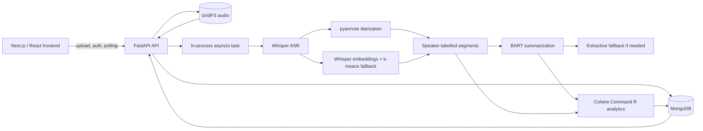

# Recapit

Recapit is an AI meeting-recap application that turns an uploaded recording into a timestamped transcript, speaker-labelled segments, a generated summary, and structured meeting analytics.

It combines several ML operating modes in one pipeline:

- local Whisper speech recognition;
- optional pretrained pyannote speaker diarization;
- an unsupervised Whisper-embedding / k-means diarization fallback;
- local BART sequence-to-sequence summarization (fine-tuned from `facebook/bart-base`);
- hosted Cohere structured analysis;
- deterministic post-processing for speaker and timing statistics; and
- an asynchronous FastAPI / MongoDB backend that serves results to a Next.js client.

The application is an inference system. The BART fine-tuning notebook and the saved Trainer artifacts that produced the bundled checkpoint are included in the repository.

## Project overview

### Capabilities

- Signup, login, logout, and authenticated meeting history
- Multipart audio upload
- MongoDB job tracking and GridFS audio storage
- Whisper transcription with detected language and word timestamps
- Speaker diarization through pyannote when configured
- Speaker-label fallback using Whisper encoder representations and k-means
- BART summary generation with an extractive fallback
- Cohere-generated action items, speaker statistics, sentiment, topics, timeline events, named entities, insights, and meeting metrics
- Transcript, summary, audio playback, and Plotly visualizations in the Next.js meeting page

### Out of scope

Durable background workers, resumable jobs, long-context chunk-and-aggregate summarization, native Zoom/Meet/Teams capture, Slack/Jira/CRM delivery, and a locally trained analytics classifier are not part of the current design. See [Limitations and roadmap](#limitations-and-roadmap).

## Architecture



### End-to-end data flow

1. The browser sends a multipart audio upload to `POST /api/v1/meetings/upload`.
2. FastAPI reads the file into memory, inserts a `meeting_jobs` document, stores the bytes in GridFS, and returns a MongoDB job ID.
3. The API schedules `run_meeting_pipeline` with `asyncio.create_task`.
4. The pipeline updates the job document at approximately 10%, 65%, 75%, 90%, and 100% progress.
5. Whisper produces a transcript and timed segments.
6. pyannote or the embedding fallback assigns speaker labels.
7. The summary path uses the sample CSV lookup, BART, or an extractive fallback.
8. Cohere receives the transcript segments and summary and returns structured JSON; deterministic speaker/time statistics are then added.
9. The transcript, segments, summary, analytics reference, and final status are persisted in MongoDB.
10. The frontend polls the job, then requests the recap and analytics.

Processing runs as a process-local task. MongoDB preserves the job document across restarts; in-flight work is not resumed.

## ML pipeline

### 1. Whisper transcription

`ai/pipeline/speech.py` defines `WhisperASR` and the asynchronous `transcribe_audio` orchestration function.

**Model loading**

- Models load with `whisper.load_model(model_name, device=...)`.
- `WHISPER_MODEL` defaults to `base`; supported sizes are `tiny`, `base`, `small`, `medium`, and `large`.
- The device is CUDA when available, otherwise CPU, unless set explicitly.
- Loaded models are cached in a module-level dictionary keyed by model and device, so repeated requests reuse the same instance.

**Audio and transcription**

The backend writes uploaded bytes to a temporary file and passes the path to Whisper. The standalone AI function also accepts raw bytes, which it preprocesses as follows:

1. `pydub` decodes the bytes;
2. audio is normalized;
3. audio is converted to mono;
4. audio is resampled to 16 kHz;
5. the result is written to a temporary WAV file.

Whisper is called with `task="transcribe"`, `word_timestamps=True`, `fp16=True` on CUDA, `verbose=False`, an optional explicit language, and optional initial-prompt support in the lower-level API.

When no language is supplied, Whisper detects it and the result's `language` field is stored on the transcript object. Each segment carries a start time, end time, and text.

If Whisper fails in the backend orchestration, a Google Speech Recognition fallback takes over. This fallback requires outbound network access and is not an offline model.

### 2. Speaker diarization

`WhisperASR` optionally loads `pyannote/speaker-diarization-3.1`. The pipeline is enabled when a Hugging Face token is supplied. Pyannote returns time intervals with speaker labels, and each Whisper segment is assigned the label with the greatest temporal overlap (a midpoint-in-interval check serves as a fast path).

The output passed to the backend is a list of records:

```json
{
  "speaker": "SPEAKER_00",
  "start": 12.4,
  "end": 18.9,
  "text": "..."
}
```

If pyannote cannot be loaded or fails during inference, the pipeline continues with the local clustering fallback.

### 3. Speaker-clustering fallback

`diarize_with_embeddings` operates on Whisper transcript segments:

1. Load each segment's audio slice with `pydub`.
2. Convert it to mono 16 kHz audio.
3. Pad short segments with silence or truncate long segments to 30 seconds.
4. Compute Whisper log-mel features.
5. Run the Whisper encoder and average its sequence output into one vector per segment.
6. Cluster the vectors with a locally implemented k-means algorithm.
7. Return a `(start, end) -> speaker label` mapping.

The cluster count comes from the `DIARIZATION_N_SPEAKERS` environment variable and defaults to `2`. K-means uses a deterministic seed of `0` and a fixed budget of `40` iterations, so results are reproducible for a given input.

This is an unsupervised method: it relies on Whisper encoder representations carrying speaker-identity signal and on a sensible configured speaker count. It labels speakers generically and does not identify real names. If clustering fails or produces no result, every segment is labelled `SPEAKER_1`.

### 4. BART summarization

The runtime loader in `ai/pipeline/summarizer.py` reads from:

```text
ai/bart_model/kaggle/working/bart-meetingbank/
```

and instantiates `BartTokenizer` and `BartForConditionalGeneration` from that local directory. The model is a BART-base-class encoder-decoder fine-tuned from `facebook/bart-base` (see [BART fine-tuning](#bart-fine-tuning)):

| Configuration | Value |
| --- | ---: |
| Encoder layers | 6 |
| Decoder layers | 6 |
| Hidden dimension (`d_model`) | 768 |
| Encoder attention heads | 12 |
| Decoder attention heads | 12 |
| Vocabulary size | 50,265 |
| Maximum position embeddings | 1,024 |
| Weight dtype | float32 |

**Runtime preprocessing and generation**

- Transcript segments are joined with spaces before tokenization.
- Inputs are tokenized with `max_length=1024` and `truncation=True`.
- Generation uses `max_length=150`, `min_length=40`, `num_beams=4`, `length_penalty=2.0`, and `early_stopping=True`.
- Special tokens are removed when decoding.

**Sample and fallback behavior**

Before loading BART, the backend checks `data/meetings.csv` by uploaded filename stem. The three sample IDs in that file receive predefined summaries and bypass BART.

For all other files:

1. BART is loaded and called.
2. If loading or generation fails, the backend splits the transcript into lines and takes up to five early sentences as an extractive fallback.
3. Very short or empty transcripts receive an explicit fallback message.

The `MeetingSummary` helper exposes placeholder fields for headline, decisions, and action items. The live backend stores the generated summary string and obtains structured action items from Cohere.

### 5. Cohere analytics

`ai/pipeline/analytics.py` builds one consolidated prompt. Each transcript segment is formatted as:

```text
[start_seconds - end_seconds] speaker: text
```

The BART summary is appended when available. The request asks Cohere `command-r-08-2024` to return JSON containing:

- action items and owners;
- speaker statistics;
- overall and segment sentiment;
- topics and keywords;
- timeline events;
- people, organizations, dates, locations, products, and documents;
- key insights; and
- meeting-level duration, speaker count, balance, decisions, questions, and engagement.

The call uses temperature `0.3` and `max_tokens=4096`. The response is trimmed, Markdown code fences are stripped if present, and `json.loads` parses the result.

After parsing, the analytics code adds metadata and derives deterministic values from the transcript segments: word counts, speaking time, turn counts, and total duration. The result is stored in the `meeting_analytics` collection and formatted into Plotly-ready structures for the frontend.

If the Cohere package is unavailable, the key is missing, the API call fails, or JSON parsing fails, analytics generation returns `None` and the meeting still completes with its transcript and summary.

## BART fine-tuning

### Training workflow

The notebook `notebook4635d1683f.ipynb` contains the full Hugging Face sequence-to-sequence workflow:

1. Check for a GPU and install notebook packages.
2. Mount Google Drive and define the model export directory.
3. Load the dataset.
4. Load `facebook/bart-base`.
5. Tokenize source and target text.
6. Configure ROUGE evaluation.
7. Create `Seq2SeqTrainingArguments`.
8. Create a `Seq2SeqTrainer`.
9. Call `trainer.train()`.
10. Evaluate on the test split, generate an example, and save the model.

Training uses the standard encoder-decoder teacher-forcing objective implemented by Hugging Face's BART model and Trainer: decoder labels are compared against next-token predictions with token-level cross-entropy. The notebook uses no custom loss, LoRA adapter, or frozen-layer strategy; all parameters are updated.

### Datasets

The notebook loads `edinburghcstr/ami` (`ihm` configuration) first, then falls back to `knkarthick/dialogsum` and `samsum` if earlier loading fails. A column-selection step picks the transcript and summary columns for tokenization.

### Preprocessing and tokenization

`preprocess_function`:

- reads `examples[transcript_col]` as source text and `examples[summary_col]` as target text;
- tokenizes inputs with `max_length=1024`, truncation, and `padding="max_length"`;
- tokenizes targets with `max_length=256`, truncation, and `padding="max_length"`;
- stores target token IDs in `model_inputs["labels"]`;
- maps over all dataset splits with `batched=True` and `num_proc=2`, removing the original columns.

### Training configuration

| Setting | Value |
| --- | --- |
| Base model | `facebook/bart-base` |
| Output directory | `./results` |
| Evaluation strategy | `epoch` |
| Save strategy | `epoch` |
| Learning rate | `3e-5` |
| Train batch size per device | `4` |
| Evaluation batch size per device | `4` |
| Epochs | `3` |
| Weight decay | `0.01` |
| Warmup steps | `500` |
| Generated evaluation | `predict_with_generate=True` |
| Evaluation generation length | `256` |
| Best-model metric | `rouge1` (higher is better) |
| Mixed precision | `fp16=torch.cuda.is_available()` |
| Checkpoint retention | `save_total_limit=2` |
| Logging | `./logs`, every 100 steps, first step enabled |
| External reporting | disabled (`report_to="none"`) |
| Hub publishing | disabled (`push_to_hub=False`) |

The optimizer and learning-rate scheduler are the Trainer defaults (AdamW with a linear schedule and warmup). Training ran on a single NVIDIA T4 GPU.

### Bundled checkpoint artifacts

The local BART directory contains:

- root model weights and tokenizer files;
- `checkpoint-1293`, `checkpoint-2586`, and `checkpoint-3879`;
- `trainer_state.json`;
- `training_args.bin`;
- scheduler, scaler, and RNG state files; and
- TensorBoard event files.

The three checkpoints correspond to global steps 1,293, 2,586, and 3,879 over three epochs. The root `model.safetensors` is byte-identical to `checkpoint-3879`, the final epoch.

### Loading for inference

The backend imports `load_bart_model()` when a filename is not in the sample CSV. The tokenizer and model load from the local artifact directory, and `generate_summary_with_bart()` applies the runtime generation settings above. The application performs inference only; it never calls `Trainer.train()`, `model.train()`, `loss.backward()`, or an optimizer.

## ML evaluation

### Metrics

The notebook uses the `evaluate` ROUGE implementation and computes `rouge1`, `rouge2`, and `rougeL`. Predictions and labels are decoded with the BART tokenizer, special tokens are skipped, label padding IDs are filtered, and `use_stemmer=True` is passed to `rouge.compute`. The Trainer evaluates the validation split at the end of each epoch, and the notebook evaluates `tokenized_dataset["test"]` after training.

- **ROUGE-1** measures unigram overlap.
- **ROUGE-2** measures bigram overlap.
- **ROUGE-L** measures longest-common-subsequence overlap.

### Results

Validation metrics recorded in each checkpoint's `trainer_state.json`:

| Checkpoint | Epoch | Eval loss | ROUGE-1 | ROUGE-2 | ROUGE-L | ROUGE-Lsum |
| --- | ---: | ---: | ---: | ---: | ---: | ---: |
| `checkpoint-1293` | 1 | 1.2775495 | 67.3553 | 56.6735 | 64.4612 | 64.4100 |
| `checkpoint-2586` | 2 | 1.1616676 | 68.5613 | 58.1061 | 65.8618 | 65.8811 |
| `checkpoint-3879` | 3 | 1.1278663 | 69.4819 | 59.0221 | 66.6411 | 66.6694 |

Every metric improves monotonically across epochs, and the final checkpoint is the one served at runtime.

### Evaluation scope

- Source sequences are truncated at 1,024 tokens and targets at 256 tokens.
- ROUGE measures lexical overlap, not factuality, coherence, or usefulness of a recap.
- Whisper, diarization, and Cohere analytics quality are not covered by an automated benchmark.

## Backend engineering

### Application structure

The FastAPI entry point is `backend/app/main.py`. Its lifespan connects to MongoDB before serving requests and closes the client on shutdown. It mounts the versioned router under `/api/v1`, configures CORS from settings, and exposes `/health`.

- `app/core/config.py`: environment-backed settings.
- `app/core/security.py`: bcrypt password hashing and JWT helpers.
- `app/db/mongo.py`: cached MongoDB client/database access.
- `app/api/v1/endpoints/auth.py`: signup, login, logout, and current-user routes.
- `app/api/v1/endpoints/ingest.py`: upload, job creation, GridFS storage, and task scheduling.
- `app/api/v1/endpoints/status.py`: meeting listing, status/detail retrieval, and GridFS audio streaming.
- `app/api/v1/endpoints/analytics.py`: analytics retrieval and UI formatting.
- `app/services/pipeline.py`: end-to-end orchestration and progress updates.

### Upload and task lifecycle

The upload handler:

1. validates that a filename exists;
2. reads the `UploadFile` into memory;
3. inserts a `meeting_jobs` document with `queued` status;
4. writes the original bytes to GridFS;
5. stores the GridFS file ID on the job; and
6. creates an in-process asyncio task.

The pipeline catches exceptions, logs them, and sets the job to `failed` with an error message. The task registry removes completed tasks and logs uncaught task exceptions.

### MongoDB usage

- `users`: account records.
- `meeting_jobs`: upload metadata, status, progress, transcript, transcript segments, summary, and analytics reference.
- `meeting_analytics`: Cohere output and derived visualization data.
- GridFS collections: original audio files.

MongoDB creates these collections on first write, so no migration step is required.

### API endpoints

| Method | Path | Purpose | Authentication |
| --- | --- | --- | --- |
| `GET` | `/health` | MongoDB-backed health probe | None |
| `POST` | `/api/v1/auth/signup` | Create user | None |
| `POST` | `/api/v1/auth/login` | Authenticate and set JWT cookie | None |
| `POST` | `/api/v1/auth/logout` | Clear JWT cookie | None |
| `GET` | `/api/v1/auth/me` | Return current user | Required |
| `POST` | `/api/v1/meetings/upload` | Store audio and queue processing | Optional |
| `GET` | `/api/v1/meetings/list` | List meetings for current user | Required |
| `GET` | `/api/v1/meetings/status/{job_id}` | Poll job status | None |
| `GET` | `/api/v1/meetings/{job_id}` | Retrieve meeting detail | None |
| `GET` | `/api/v1/meetings/{job_id}/audio` | Stream GridFS audio | None |
| `GET` | `/api/v1/analytics/{job_id}` | Retrieve analytics | Optional cookie; ownership checked when a user is present |
| `GET` | `/api/v1/analytics/{job_id}/action-items` | Retrieve action items | Optional cookie |
| `GET` | `/api/v1/analytics/{job_id}/speaker-stats` | Retrieve speaker chart data | Optional cookie |
| `GET` | `/api/v1/analytics/{job_id}/sentiment` | Retrieve sentiment data | Optional cookie |
| `GET` | `/api/v1/analytics/{job_id}/topics` | Retrieve topic data | Optional cookie |
| `GET` | `/api/v1/analytics/{job_id}/timeline` | Retrieve timeline data | Optional cookie |

Status, detail, and audio routes are addressed by MongoDB job ID and do not currently require authentication. Public deployments should add ownership checks to these routes (see the roadmap).

## Frontend integration

The frontend is a Next.js App Router application under `frontend/app`.

- `app/page.tsx` provides landing-page upload and polling.
- `app/login.tsx` and `app/signup.tsx` call the authentication routes.
- `app/dashboard/page.tsx` loads the authenticated user's meeting list.
- `app/meetings/[jobId]/page.tsx` and its client component poll the meeting record, request audio, and render the recap.
- Transcript components display speaker labels, timestamps, and text.
- Analytics components request the analytics endpoints and render Plotly charts.

Components read `NEXT_PUBLIC_API_BASE` (default `http://localhost:8000`). The frontend polls roughly every 2.5 seconds until a terminal job status arrives. Authentication uses the `access_token` cookie set by the backend.

## Data and model flow

| Output | Producer | Persistence / consumer |
| --- | --- | --- |
| Audio bytes | Browser upload | MongoDB GridFS; audio endpoint |
| Transcript text | Whisper, or Google fallback | `meeting_jobs`; recap page |
| Segment timestamps | Whisper | `meeting_jobs.transcript_segments` |
| Speaker labels | pyannote, k-means, or `SPEAKER_1` fallback | Transcript segments |
| Summary for sample IDs | `data/meetings.csv` lookup | `meeting_jobs.summary` |
| Summary for other IDs | Local BART or extractive fallback | `meeting_jobs.summary` |
| Action items, topics, etc. | Cohere JSON response | `meeting_analytics`; analytics UI |
| Counts and durations | Deterministic segment calculations | `meeting_analytics`; charts |

Not every displayed value comes from a learned model: CSV summaries, the extractive fallback, speaker/time enrichment, and UI formatting are deterministic code paths.

## Technology stack and design decisions

| Area | Technology | Responsibility |
| --- | --- | --- |
| Web client | Next.js 16, React 19, TypeScript | Upload, polling, recap UI |
| API | FastAPI, Uvicorn | HTTP routes and application lifecycle |
| Persistence | MongoDB, PyMongo, GridFS | Jobs, users, analytics, audio |
| ASR | OpenAI Whisper, PyTorch | Speech-to-text and timestamps |
| Diarization | pyannote.audio | Pretrained speaker intervals |
| Fallback clustering | Whisper encoder, local k-means | Speaker grouping without pyannote |
| Summarization | Transformers BART | Local conditional generation |
| Hosted analytics | Cohere Command R | Structured meeting analysis |
| Audio | pydub, ffmpeg | Decode, normalize, resample |
| Visualizations | Plotly, React Plotly | Browser-rendered analytics |

**Design decisions**

- **Single Cohere request.** One consolidated call keeps all analytics fields coherent and minimizes round trips, at the cost of depending on JSON compliance from one hosted call.
- **In-process tasks.** Running the pipeline as an asyncio task keeps deployment to a single service with no queue infrastructure.
- **Local BART.** Summarization runs on-device with no hosted dependency, trading disk and memory for privacy and cost control.
- **Layered fallbacks.** Every stage degrades gracefully (pyannote → k-means → single speaker; BART → extractive; Cohere → transcript and summary only), so a job always produces a usable recap.

## Project structure

```text
ai/
  pipeline/
    speech.py          Whisper, audio preprocessing, diarization, clustering
    summarizer.py      BART loading and generation
    analytics.py       Cohere prompt, parsing, storage, chart formatting
    extractor.py       Legacy fixed-value extractor
  bart_model/          BART model, tokenizer, checkpoints, Trainer metadata
  pyproject.toml       AI package and Whisper extra
  requirements-*.txt   Analytics and Whisper dependency lists

backend/app/
  main.py              FastAPI entry point and lifespan
  core/                Settings and security helpers
  db/                  MongoDB client
  models/              Pydantic request/response models
  services/pipeline.py End-to-end orchestration
  api/v1/endpoints/    Authentication, ingest, status, analytics
  pyproject.toml       Backend dependencies and Uvicorn configuration

frontend/app/
  page.tsx             Landing page and upload flow
  dashboard/           Meeting list
  meetings/[jobId]/    Meeting recap
  components/          Upload, transcript, audio, analytics UI
  package.json         Frontend scripts and dependencies

data/meetings.csv      Sample filename-to-summary records
notebook4635d1683f.ipynb
                       BART fine-tuning workflow
```

## Local setup and execution

### Prerequisites

- Python 3.11 or newer
- Node.js and npm compatible with `frontend/package.json`
- MongoDB, local or hosted
- `ffmpeg` on `PATH`
- Disk space for the BART artifacts and the Whisper cache
- A Cohere API key for analytics
- Optional Hugging Face access for pyannote

The four bundled BART weight files are about 558 MB each (roughly 2.2 GB total) and are stored with Git LFS (see [Model weights](#model-weights)).

### 1. Start MongoDB

```bash
docker run --name recapit-mongo -p 27017:27017 -d mongo:7
```

If the container already exists:

```bash
docker start recapit-mongo
```

### 2. Create the Python environment and install the backend

From the repository root:

```bash
python3.11 -m venv .venv
source .venv/bin/activate
python -m pip install --upgrade pip

cd backend
python -m pip install -e ".[dev]"
```

The backend `pyproject.toml` includes FastAPI, Uvicorn, PyMongo, Transformers, Torch, librosa, pyannote.audio, SpeechRecognition, and pydub.

### 3. Install AI and analytics dependencies

From the repository root, with the same environment active:

```bash
cd ai
python -m pip install -e ".[whisper]"
python -m pip install -r requirements-analytics.txt
cd ..
```

The AI extra includes OpenAI Whisper, Torch/Torchaudio, pydub, soundfile, ffmpeg-python, pyannote, Transformers, NumPy, SciPy, and related packages. The analytics requirements add Cohere, PyMongo, matplotlib, Plotly, pandas, NumPy, and seaborn.

Install ffmpeg on Debian/Ubuntu if needed:

```bash
sudo apt-get install ffmpeg
```

For NVIDIA GPUs, install the PyTorch build that matches your CUDA version.

### 4. Configure environment variables

Create `backend/.env`:

| Variable | Required | Runtime use |
| --- | --- | --- |
| `MONGO_URI` | Yes | MongoDB connection |
| `MONGO_DB_NAME` | Yes | Database name (normally `recapit`) |
| `CORS_ORIGINS` | Yes for browser use | Allowed frontend origins |
| `COHERE_API_KEY` | For analytics | Cohere client initialization |
| `WHISPER_MODEL` | No | Whisper size; defaults to `base` |
| `WHISPER_DEVICE` | No | Device setting; auto-detected when unset |
| `WHISPER_VERBOSE` | No | Whisper verbosity |
| `HUGGINGFACE_TOKEN` | Optional | pyannote model access |
| `DIARIZATION_N_SPEAKERS` | No | Cluster count for the k-means fallback; defaults to `2` |
| `API_PREFIX` | No | API prefix; defaults to `/api/v1` |
| `APP_NAME` | No | FastAPI title |

```dotenv
MONGO_URI=mongodb://localhost:27017
MONGO_DB_NAME=recapit
CORS_ORIGINS=http://localhost:3000
COHERE_API_KEY=replace-with-your-cohere-key
WHISPER_MODEL=base
WHISPER_DEVICE=auto
WHISPER_VERBOSE=false
HUGGINGFACE_TOKEN=replace-with-your-huggingface-token
```

Create `frontend/.env.local`:

```dotenv
NEXT_PUBLIC_API_BASE=http://localhost:8000
```

### 5. Start the backend

In terminal 1, from the repository root:

```bash
source .venv/bin/activate
cd backend
python -m uvicorn app.main:app --host 0.0.0.0 --port 8000 --reload
```

Port `8000` matches the frontend's default API base. Verify the health endpoint:

```bash
curl http://localhost:8000/health
```

Expected response:

```json
{"status":"ok"}
```

### 6. Install and start the frontend

In terminal 2, from the repository root:

```bash
cd frontend
npm install
npm run dev
```

Open <http://localhost:3000>, create an account, and upload an audio file (MP3, WAV, M4A, or OGG).

### 7. API smoke test

Create an account and keep the cookie:

```bash
curl -i -c cookies.txt \
  -H 'Content-Type: application/json' \
  -d '{"email":"you@example.com","password":"choose-a-password"}' \
  http://localhost:8000/api/v1/auth/signup
```

Upload a file:

```bash
curl -i -c cookies.txt -b cookies.txt \
  -F 'file=@/absolute/path/to/meeting.mp3' \
  http://localhost:8000/api/v1/meetings/upload
```

Poll using the returned `job_id`:

```bash
curl -b cookies.txt http://localhost:8000/api/v1/meetings/status/<job_id>
curl -b cookies.txt http://localhost:8000/api/v1/meetings/<job_id>
curl -b cookies.txt http://localhost:8000/api/v1/analytics/<job_id>
```

## Testing

Frontend checks:

```bash
cd frontend
npm run lint
npm run build
```

pytest is included as a backend dev dependency for unit tests. End-to-end verification checklist:

1. MongoDB is reachable.
2. `GET /health` returns `{"status":"ok"}`.
3. Signup and login set the `access_token` cookie.
4. An upload returns a job ID.
5. Status moves through processing to completed or failed.
6. Transcript segments and summary appear in the meeting response.
7. Audio streams from the GridFS endpoint.
8. Analytics returns completed data when Cohere is configured.

## Troubleshooting

**Backend fails at startup.** The lifespan connects to MongoDB. Check `MONGO_URI`, MongoDB availability, and network access first.

**`ModuleNotFoundError` for Whisper, Transformers, or Cohere.** Activate the virtual environment used to start Uvicorn and install the backend package plus the AI and analytics dependencies. `backend/requirements.txt` deliberately comments out the heavyweight AI packages for lightweight deployments.

**Audio decoding fails.** Install ffmpeg and confirm it is on `PATH`.

**First inference is slow.** Whisper downloads its model on first use, and pyannote downloads its pretrained pipeline (Hugging Face authorization required).

**No speaker separation.** Without pyannote access the app uses Whisper-embedding clustering; if that fails, every segment is labelled `SPEAKER_1`. Set `DIARIZATION_N_SPEAKERS` to match the meeting.

**No analytics.** Install the Cohere dependency, set `COHERE_API_KEY`, and make sure outbound network access is available. Analytics failures do not fail the meeting job.

**Unfinished jobs after a restart.** Tasks are in-process; MongoDB keeps the job record, but unfinished work is not resumed. Re-upload the recording.

**Summaries cover only the start of a long meeting.** BART input is capped at 1,024 tokens (see roadmap).

## Demonstration data

`data/meetings.csv` contains three sample filename-to-summary rows. They are predefined records used by the backend for demos and are not model-generated outputs. Checkpoint metrics are listed under [ML evaluation](#ml-evaluation).

## Limitations and roadmap

**Current limitations**

- process-local asynchronous work with no durable queue or restart recovery;
- whole-file upload reads and no configured upload-size limit;
- BART is loaded per summary request rather than from a shared cache;
- 1,024-token summarization input;
- default two-speaker clustering in the fallback diarizer;
- hosted Cohere dependency with lenient JSON parsing;
- no ownership enforcement on status, detail, and audio routes;
- no automated ML quality suite or human evaluation;
- about 2.2 GB of local BART artifacts.

**Roadmap**

- durable worker queue with retries;
- model warm-up and a shared model cache;
- chunked / hierarchical summarization for long meetings;
- explicit model and version metadata on every recap;
- Pydantic schema validation and a retry/repair loop for Cohere output;
- per-route authorization and ownership checks;
- upload-size and concurrency limits;
- dataset manifests and a reproducible held-out evaluation with human quality review.

## Model weights

Recapit uses a local BART checkpoint for meeting summarization. The weights are stored with [Git Large File Storage (Git LFS)](https://git-lfs.com/). Install Git LFS before cloning:

```bash
git lfs install
git clone <YOUR_GITHUB_REPOSITORY_URL>
cd <YOUR_REPOSITORY_NAME>
git lfs pull
```

Keep `.env` files, API keys, virtual environments, `node_modules`, `.next`, `__pycache__`, and logs out of Git via `.gitignore`.
