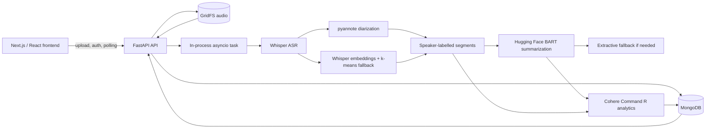

# Recapit

Recapit is an AI meeting-recap application that turns an uploaded recording
into a timestamped transcript, speaker-labelled segments, a generated
summary, and structured meeting analytics.

The project is technically interesting because it combines several different
ML operating modes in one pipeline:

- local Whisper speech recognition;
- optional pretrained pyannote speaker diarization;
- an unsupervised Whisper-embedding/k-means fallback;
- private Hugging Face BART sequence-to-sequence summarization;
- hosted Cohere structured analysis;
- deterministic post-processing for speaker and timing statistics; and
- an asynchronous FastAPI/MongoDB application that exposes the results to a
  Next.js client.

The application is an inference system. A BART fine-tuning notebook and saved
Trainer artifacts are included as experiment material, but the bundled
checkpoint's complete training provenance is not packaged as a reproducible
training release.

## Project overview

### Capabilities

- Signup, login, logout, and authenticated meeting history
- Multipart audio upload
- MongoDB job tracking and GridFS audio storage
- Whisper transcription with detected language and word timestamps
- Speaker diarization through pyannote when configured
- Speaker-label fallback using Whisper encoder representations and k-means
- BART summary generation with an extractive fallback
- Cohere-generated action items, speaker statistics, sentiment, topics,
  timeline events, named entities, insights, and meeting metrics
- Transcript, summary, audio playback, and Plotly visualizations in the
  Next.js meeting page

### What is not implemented

The current source does not implement durable background workers, resumable
jobs, long-context chunk-and-aggregate summarization, native Zoom/Meet/Teams
capture, Slack/Jira/CRM delivery, or a locally trained analytics classifier.

## Architecture



### End-to-end data flow

1. The browser sends a multipart audio upload to
   `POST /api/v1/meetings/upload`.
2. FastAPI reads the complete file into memory, inserts a `meeting_jobs`
   document, stores the bytes in GridFS, and returns a MongoDB job ID.
3. The API schedules `run_meeting_pipeline` with `asyncio.create_task`.
4. The pipeline writes progress at approximately 10%, 65%, 75%, 90%, and
   100% while updating the job document.
5. Whisper produces a transcript and timed segments.
6. pyannote or the embedding fallback assigns speaker labels.
7. The summary path uses the private Hugging Face BART
   model, or an extractive fallback.
8. Cohere receives the transcript segments and summary, returns structured
   JSON, and deterministic speaker/time statistics are added.
9. The transcript, segments, summary, analytics reference, and final status
   are persisted in MongoDB.
10. The frontend polls the job and then requests the recap and analytics.

The task is process-local. MongoDB preserves the job document, but an API
restart does not resume an in-memory task.

## ML pipeline

### 1. Whisper transcription

`ai/pipeline/speech.py` defines `WhisperASR` and the asynchronous
`transcribe_audio` orchestration function.

#### Model loading

- The model is loaded with `whisper.load_model(model_name, device=...)`.
- `WHISPER_MODEL` defaults to `base`; supported sizes in the code include
  `tiny`, `base`, `small`, `medium`, and `large`.
- The device is CUDA when available, otherwise CPU, unless configured
  explicitly.
- Models are cached in a module-level dictionary keyed by model/device so
  repeated requests do not reload the same Whisper model.

#### Audio and transcription

The backend currently writes uploaded bytes to a temporary file and passes the
file path to Whisper. The standalone AI function also supports raw bytes:

1. `pydub` decodes the bytes;
2. audio is normalized;
3. audio is converted to mono;
4. audio is resampled to 16 kHz;
5. the normalized audio is written to a temporary WAV file.

Whisper is called with:

- `task="transcribe"`;
- `word_timestamps=True`;
- `fp16=True` when CUDA is available;
- `verbose=False`;
- optional explicit language;
- optional initial prompt support in the lower-level API.

When language is not supplied, Whisper detects it and the result's
`language` field is stored in the transcript object. Each returned segment
contains start time, end time, and text.

If Whisper fails in the backend orchestration, the code contains a Google
Speech Recognition fallback. That fallback requires outbound network access
and is not an offline local model.

### 2. Speaker diarization

`WhisperASR` optionally loads:

```text
pyannote/speaker-diarization-3.1
```

The pipeline is enabled only when a Hugging Face token is supplied. Pyannote
returns time intervals and speaker labels. Whisper segments are assigned the
label with the greatest temporal overlap; a midpoint-in-interval check is used
as a fast assignment path.

The output passed to the backend is a list of records shaped like:

```json
{
  "speaker": "SPEAKER_00",
  "start": 12.4,
  "end": 18.9,
  "text": "..."
}
```

If pyannote cannot be loaded or fails during inference, the pipeline continues
to the local clustering fallback.

### 3. Speaker-clustering fallback

`diarize_with_embeddings` operates on Whisper transcript segments:

1. Load each segment's audio slice with `pydub`.
2. Convert it to mono 16 kHz audio.
3. Pad short segments with silence or truncate long segments to 30 seconds.
4. Compute Whisper log-mel features.
5. Run the Whisper encoder and average its sequence output into one vector
   per segment.
6. Cluster the vectors with a locally implemented k-means algorithm.
7. Return a `(start, end) -> speaker label` mapping.

The number of clusters defaults to the `DIARIZATION_N_SPEAKERS` environment
variable, or `2` when it is absent. The implementation uses a deterministic
random seed of `0` and a fixed iteration budget of `40`.

This is an unsupervised heuristic. It assumes a useful relationship between
Whisper encoder representations and speaker identity, assumes the configured
number of speakers is reasonable, and does not identify real names. If
clustering fails or no diarization result is available, every segment is
labelled `SPEAKER_1`.

### 4. BART summarization

The runtime loader in `ai/pipeline/summarizer.py` loads the private Hugging
Face model `Neyati/recapit-meetingbank-bart`. The model is not bundled in this
repository. Its weights are fetched at runtime using the Hugging Face token
configured in `HUGGINGFACE_TOKEN`.

The intended fine-tuned artifact is the `checkpoint-1938` export. The current
application configuration supports an optional `SUMMARIZER_MODEL_REVISION`,
but its default is empty, so deployment must set that variable if the
repository's default revision is not already the intended export. The source
does not independently verify that the private repository's default revision
resolves to `checkpoint-1938`.

#### Runtime preprocessing and generation

- Transcript segments are joined with spaces before tokenization.
- Input tokenization uses `max_length=1024` and `truncation=True`.
- There is no chunk-and-aggregate strategy, so longer meetings lose content
  beyond the first 1,024 tokens.
- Generation uses `num_beams=4`, `max_new_tokens=256`,
  `min_new_tokens=16`, `length_penalty=2.0`,
  `no_repeat_ngram_size=3`, `early_stopping=True`, `do_sample=False`, and
  `use_cache=True`.
- The inherited generation configuration is copied and its `max_length` and
  `min_length` values are cleared before the explicit new-token limits are
  applied.
- The model is loaded lazily once per process and protected by a lock so
  concurrent jobs do not initialize duplicate copies.
- Loading and generation are run in a worker thread from the async backend
  pipeline. This prevents synchronous inference from directly blocking the
  event loop, but it does not make CPU inference fast or make jobs durable.
- The decoded sequence removes special tokens.

#### Sample-specific and fallback behavior

Before loading BART, the backend checks `data/meetings.csv` by uploaded
filename stem. The three sample IDs in that file receive predefined summaries
and do not exercise BART.

For other files:

1. The configured Hugging Face BART model is loaded and called.
2. If loading or generation fails, the backend splits transcript lines and
   takes up to five early sentences as an extractive fallback.
3. Very short or empty transcripts receive an explicit fallback message.

The `MeetingSummary` helper also exposes placeholder fields for headline,
decisions, and action items; the live backend primarily stores the generated
summary string and obtains structured action items from Cohere.

### 5. Cohere analytics

`ai/pipeline/analytics.py` builds one consolidated prompt. Each transcript
segment is formatted as:

```text
[start_seconds - end_seconds] speaker: text
```

The optional BART summary is appended to the prompt. The request asks Cohere
`command-r-08-2024` to return JSON containing:

- action items and owners;
- speaker statistics;
- overall and segment sentiment;
- topics and keywords;
- timeline events;
- people, organizations, dates, locations, products, and documents;
- key insights; and
- meeting-level duration, speaker count, balance, decisions, questions, and
  engagement.

The API call uses temperature `0.3` and `max_tokens=4096`. The response is
trimmed, Markdown code fences are removed if present, and `json.loads` parses
the result.

After parsing, the analytics code adds metadata and derives deterministic
values from the transcript segments, including word counts, speaking time,
turn counts, and total duration. The result is stored in the
`meeting_analytics` collection and formatted into Plotly-oriented structures
for the frontend.

If the Cohere package is unavailable, the key is missing, the API call fails,
or JSON parsing fails, analytics generation returns `None`. The meeting
pipeline can still finish with transcript and summary data. There is no strict
Pydantic schema validation or retry/repair loop for Cohere output.

## BART fine-tuning

### Training workflow present in the notebook

The repository includes `meetingbank_bart_finetune_final.ipynb`, a Hugging
Face sequence-to-sequence training notebook.

1. Check for a GPU and install notebook packages.
2. Mount Google Drive and define a model export directory.
3. Load a dataset.
4. Load the BART base model used by the experiment.
5. Tokenize source and target text.
6. Configure ROUGE evaluation.
7. Create `Seq2SeqTrainingArguments`.
8. Create a `Seq2SeqTrainer`.
9. Call `trainer.train()`.
10. Evaluate on the test split, generate an example, and save the model.

The training code uses the standard encoder-decoder teacher-forcing objective implemented by Hugging Face's BART model and Trainer. The decoder is trained against the target token labels using token-level cross-entropy, and optimizer updates are applied during `trainer.train()`. The notebook does not implement a custom loss, LoRA adapter, or frozen-layer strategy.

### Dataset and provenance

The intended fine-tuning dataset for the deployed model is
`huuuyeah/meetingbank`. The base model is `facebook/bart-large-xsum`, and the
intended best checkpoint is `checkpoint-1938`, published in the private model
repository above.

The repository does not contain a complete, independently reproducible
training run or a local copy of the private model weights. Do not interpret
the notebook outputs as proof that the current private model was reproduced
by this application.

### Preprocessing and tokenization

The notebook's `preprocess_function`:

- reads `examples[transcript_col]` as source text;
- reads `examples[summary_col]` as target text;
- tokenizes inputs with `max_length=1024` and truncation;
- tokenizes targets with `max_length=256` and truncation;
- stores target token IDs in `model_inputs["labels"]`;
- maps over all dataset splits with `batched=True` and removes the original
  columns. Padding is applied later by `DataCollatorForSeq2Seq`.

### Training configuration

The values explicitly configured in the notebook are:

| Setting | Value |
| --- | --- |
| Intended deployed base model | `facebook/bart-large-xsum` |
| Intended fine-tuning dataset | `huuuyeah/meetingbank` |
| Intended deployed checkpoint | `checkpoint-1938` |
| Output directory | `DIRS["checkpoints"]` |
| Evaluation strategy | `epoch` |
| Save strategy | `epoch` |
| Learning rate | `2e-5` |
| Train batch size per device | `1` |
| Gradient accumulation | `8` |
| Evaluation batch size per device | `2` |
| Epochs | `4` |
| Weight decay | `0.01` |
| Warmup | `warmup_ratio=0.05` |
| Generated evaluation during training | `predict_with_generate=False` |
| Best-model metric | `eval_loss`, lower is better |
| Gradient checkpointing | enabled |
| Mixed precision | `fp16=torch.cuda.is_available()` |
| Checkpoint retention | `save_total_limit=2` |
| Logging | every 50 steps |
| External reporting | disabled (`report_to="none"`) |
| Random seeds | configured `seed` and `data_seed` |

The notebook does not explicitly name an optimizer or scheduler; it relies on
Trainer defaults. CUDA was available in the recorded Colab run, so fp16 was
enabled for that run; this is not a deployment requirement.

The notebook records `checkpoint-1938` as the best checkpoint at global step
1,938, with a best validation loss of `1.020616`. The checkpoint was then
loaded and its validation loss was recomputed as approximately `1.0204` in the
notebook environment. These are notebook results, not a claim that this
repository reproduces training.

### Loading for application inference

The backend imports `load_bart_model()` when a filename is not found in the
sample CSV. The tokenizer and model are loaded from the private Hugging Face
repository, then `generate_summary_with_bart()` applies the runtime generation
settings described above. The application performs inference only; it does
not call `Trainer.train()`, `model.train()`, `loss.backward()`, or an
optimizer.

## ML evaluation

### Notebook metric implementation

The notebook loads the `evaluate` ROUGE implementation and computes
ROUGE-1, ROUGE-2, ROUGE-L, and ROUGE-Lsum on the test evaluation path.

Predictions and labels are decoded with the BART tokenizer, special tokens are skipped, and `use_stemmer=True` is passed to `rouge.compute`. The notebook's official test evaluation computes deterministic per-example ROUGE means over all 862 test items. Generation uses `num_beams=4`, `max_new_tokens=256`, `min_new_tokens=16`, `length_penalty=2.0`, `no_repeat_ngram_size=3`, `early_stopping=True`, and `do_sample=False`. These are the official evaluation settings; the notebook's separate qualitative example uses different decoding settings.

ROUGE-1 measures unigram overlap, ROUGE-2 measures bigram overlap, ROUGE-L
measures longest-common-subsequence overlap, and ROUGE-Lsum is the
summary-oriented variant reported by the evaluation output.

### Recorded notebook evaluation

The saved notebook output reports the following scores on the 862-example
MeetingBank test split:

| Subset | ROUGE-1 | ROUGE-2 | ROUGE-L | ROUGE-Lsum |
| --- | ---: | ---: | ---: | ---: |
| All test examples | 71.30 | 61.06 | 68.47 | 69.08 |
| Source at most 1,024 tokens (416 examples) | 72.07 | 61.92 | 69.18 | 69.69 |
| Source over 1,024 tokens, truncated (446 examples) | 70.59 | 60.27 | 67.81 | 68.51 |

These are saved notebook outputs, not independently reproduced application
benchmarks. The notebook also reports a validation smoke test, but labels it
as sanity-only rather than a formal metric.

## Backend engineering

### Application structure

The FastAPI entry point is `backend/app/main.py`. Its lifespan connects to
MongoDB before serving requests and closes the client on shutdown. It mounts
the versioned router under `/api/v1`, configures CORS from settings, and
exposes `/health`.

Important backend modules:

- `app/core/config.py`: environment-backed settings.
- `app/core/security.py`: bcrypt password hashing and JWT helpers.
- `app/db/mongo.py`: cached MongoDB client/database access.
- `app/api/v1/endpoints/auth.py`: signup, login, logout, and current-user
  routes.
- `app/api/v1/endpoints/ingest.py`: upload, MongoDB job creation, GridFS
  storage, and task scheduling.
- `app/api/v1/endpoints/status.py`: meeting listing, status/detail retrieval,
  and GridFS audio streaming.
- `app/api/v1/endpoints/analytics.py`: analytics retrieval and UI formatting.
- `app/services/pipeline.py`: end-to-end orchestration and progress updates.

### Upload and task lifecycle

The upload handler:

1. validates that a filename exists;
2. reads the entire `UploadFile` into memory;
3. inserts a `meeting_jobs` document with `queued` status;
4. writes the original bytes to GridFS;
5. stores the GridFS file ID on the job; and
6. creates an in-process asyncio task.

The pipeline catches exceptions, logs them, and updates the job to `failed`
with an error message. The task registry removes completed tasks and logs
uncaught task exceptions. There is no durable queue, retry policy, worker
process, cancellation endpoint, upload-size limit, or restart recovery.

### MongoDB usage

The code uses:

- `users` for account records;
- `meeting_jobs` for upload metadata, status, progress, transcript,
  transcript segments, summary, and analytics reference;
- `meeting_analytics` for Cohere output and derived visualization data; and
- GridFS collections for original audio files.

MongoDB creates these collections on first write. No migration command is
defined.

### API endpoints

| Method | Path | Purpose | Authentication in source |
| --- | --- | --- | --- |
| `GET` | `/health` | MongoDB-backed health probe | None |
| `POST` | `/api/v1/auth/signup` | Create user | None |
| `POST` | `/api/v1/auth/login` | Authenticate and set JWT cookie | None |
| `POST` | `/api/v1/auth/logout` | Clear JWT cookie | None |
| `GET` | `/api/v1/auth/me` | Return current user | Required |
| `POST` | `/api/v1/meetings/upload` | Store audio and queue processing | Optional |
| `GET` | `/api/v1/meetings/list` | List meetings for current user | Required |
| `GET` | `/api/v1/meetings/status/{job_id}` | Poll job status | None |
| `GET` | `/api/v1/meetings/{job_id}` | Retrieve meeting detail | None |
| `GET` | `/api/v1/meetings/{job_id}/audio` | Stream GridFS audio | None |
| `GET` | `/api/v1/analytics/{job_id}` | Retrieve analytics | Optional cookie; ownership checked when user is present |
| `GET` | `/api/v1/analytics/{job_id}/action-items` | Retrieve action items | Optional cookie |
| `GET` | `/api/v1/analytics/{job_id}/speaker-stats` | Retrieve speaker chart data | Optional cookie |
| `GET` | `/api/v1/analytics/{job_id}/sentiment` | Retrieve sentiment data | Optional cookie |
| `GET` | `/api/v1/analytics/{job_id}/topics` | Retrieve topic data | Optional cookie |
| `GET` | `/api/v1/analytics/{job_id}/timeline` | Retrieve timeline data | Optional cookie |

## Frontend integration

The frontend is a Next.js App Router application under `frontend/app`.

- `app/page.tsx` provides landing-page upload and polling behavior.
- `app/login.tsx` and `app/signup.tsx` call the authentication routes.
- `app/dashboard/page.tsx` loads the authenticated user's meeting list.
- `app/meetings/[jobId]/page.tsx` and its client component poll the meeting
  record, request audio, and render the recap.
- Transcript components display speaker labels, timestamps, and text.
- Analytics components request the analytics endpoints and render Plotly
  charts.

Most components use `NEXT_PUBLIC_API_BASE`, defaulting to
`http://localhost:8000`. The frontend polls approximately every 2.5 seconds
until a terminal job status is received. Authentication uses the
`access_token` cookie returned by the backend.

## Data and model flow

| Output | Producer | Persistence/consumer |
| --- | --- | --- |
| Audio bytes | Browser upload | MongoDB GridFS; audio endpoint |
| Transcript text | Whisper, or Google fallback | `meeting_jobs`; recap page |
| Segment timestamps | Whisper | `meeting_jobs.transcript_segments` |
| Speaker labels | pyannote, k-means, or `SPEAKER_1` fallback | Transcript segments |
| Summary for sample IDs | `data/meetings.csv` lookup | `meeting_jobs.summary` |
| Summary for other IDs | Private Hugging Face BART or extractive fallback | `meeting_jobs.summary` |
| Action items/topics/etc. | Cohere JSON response | `meeting_analytics`; analytics UI |
| Counts and durations | Deterministic segment calculations | `meeting_analytics`; charts |

This distinction matters: not every displayed value is produced by a learned
model. The CSV summaries, extractive fallback, speaker/time enrichment, and
some UI formatting are deterministic code paths.

## Technology stack and design decisions

| Area | Technology | Responsibility |
| --- | --- | --- |
| Web client | Next.js 16, React 19, TypeScript | Upload, polling, recap UI |
| API | FastAPI, Uvicorn | HTTP routes and application lifecycle |
| Persistence | MongoDB, PyMongo, GridFS | Jobs, users, analytics, audio |
| ASR | OpenAI Whisper, PyTorch | Speech-to-text and timestamps |
| Diarization | pyannote.audio | Optional pretrained speaker intervals |
| Fallback clustering | Whisper encoder, local k-means | Speaker grouping without pyannote |
| Summarization | Transformers BART from Hugging Face Hub | Private conditional generation |
| Hosted analytics | Cohere Command R | Structured meeting analysis |
| Audio | pydub and ffmpeg | Decode, normalize, resample |
| Visualizations | Plotly and React Plotly | Browser-rendered analytics |

The single Cohere request keeps all analytics fields coupled into one response
and reduces round trips. The trade-off is dependence on JSON compliance and a
single hosted call. The process-local task model keeps the application simple
but limits reliability and horizontal scalability. The private BART model
avoids storing weights in this repository but requires Hugging Face access,
substantial memory, and a model cache.

## Project structure

```text
ai/
  pipeline/
    speech.py          Whisper, audio preprocessing, diarization, clustering
    summarizer.py      Hugging Face BART loading and generation
    analytics.py       Cohere prompt, parsing, storage, chart formatting
    extractor.py       Legacy fixed-value extractor
  bart_model/          BART model, tokenizer, checkpoints, Trainer metadata
  pyproject.toml       AI package and Whisper extra
  requirements-*.txt   Analytics and Whisper dependency lists

backend/app/
  main.py              FastAPI entry point and lifespan
  core/                Settings and security helpers
  db/                  MongoDB client
  models/              Pydantic request/response models
  services/pipeline.py End-to-end orchestration
  api/v1/endpoints/    Authentication, ingest, status, analytics
  pyproject.toml       Backend dependencies and Uvicorn configuration

frontend/app/
  page.tsx             Landing page and upload flow
  dashboard/           Meeting list
  meetings/[jobId]/    Meeting recap
  components/          Upload, transcript, audio, analytics UI
  package.json          Frontend scripts and dependencies

data/meetings.csv      Sample filename-to-summary records
meetingbank_bart_finetune_final.ipynb
                         BART fine-tuning workflow and saved outputs
```

## Local setup and execution

The following commands are based on the checked-in Python package metadata,
frontend package scripts, environment settings, and application entry points.
They have not been validated by launching a live database or service in this
workspace.

### Prerequisites

- Python 3.11 or newer
- Node.js and npm compatible with `frontend/package.json`
- MongoDB, local or hosted
- `ffmpeg` on `PATH`
- Disk space for the Hugging Face model cache and Whisper cache
- A Cohere API key for analytics
- A Hugging Face read token with access to the private summarizer repository
  when using non-demo summaries

### 1. Start MongoDB

For a local Docker MongoDB:

```bash
docker run --name recapit-mongo -p 27017:27017 -d mongo:7
```

If it already exists:

```bash
docker start recapit-mongo
```

### 2. Create the Python environment and install backend dependencies

From the repository root:

```bash
python3.11 -m venv .venv
source .venv/bin/activate
python -m pip install --upgrade pip

cd backend
python -m pip install -e ".[dev]"
```

The backend `pyproject.toml` includes FastAPI, Uvicorn, PyMongo,
Transformers, Torch, librosa, pyannote.audio, SpeechRecognition, and pydub.
The Docker-oriented `backend/requirements.txt` also installs the runtime
`torch` and `transformers` packages needed by the summarizer.

### 3. Install AI and analytics dependencies

From the repository root with the same environment active:

```bash
cd ai
python -m pip install -e ".[whisper]"
python -m pip install -r requirements-analytics.txt
cd ..
```

The AI extra includes OpenAI Whisper, Torch/Torchaudio, pydub, soundfile,
ffmpeg-python, pyannote, Transformers, NumPy, SciPy, and related packages.
The analytics requirements add Cohere, PyMongo, matplotlib, Plotly, pandas,
NumPy, and seaborn.

Install ffmpeg separately on Debian/Ubuntu if needed:

```bash
sudo apt-get install ffmpeg
```

The repository does not select a CUDA-specific PyTorch wheel. For NVIDIA
hardware, install the PyTorch build appropriate for the installed CUDA version.

### 4. Configure environment variables

Create `backend/.env` for local backend development. This file is ignored by
Git; never commit token or database values. The backend reads these settings
through `backend/app/core/config.py`:

| Variable | Required | Runtime use |
| --- | --- | --- |
| `MONGO_URI` | Yes | MongoDB connection |
| `MONGO_DB_NAME` | Yes | Database name; normally `recapit` |
| `CORS_ORIGINS` | Yes for browser use | Allowed frontend origins |
| `COHERE_API_KEY` | For analytics | Cohere client initialization |
| `WHISPER_MODEL` | No | Whisper size; defaults to `base` |
| `WHISPER_DEVICE` | No | Device setting; auto-detected when unset |
| `WHISPER_VERBOSE` | No | Whisper verbosity setting |
| `HUGGINGFACE_TOKEN` | For private summarizer/pyannote | Hugging Face read access |
| `SUMMARIZER_MODEL_ID` | No | Defaults to `Neyati/recapit-meetingbank-bart` |
| `SUMMARIZER_MODEL_REVISION` | Recommended | Optional revision; set to `checkpoint-1938` only if that is the revision exposed by the private repository |
| `API_PREFIX` | No | API prefix; defaults to `/api/v1` |
| `APP_NAME` | No | FastAPI title |

Example local configuration:

```dotenv
MONGO_URI=mongodb://localhost:27017
MONGO_DB_NAME=recapit
CORS_ORIGINS=http://localhost:3000
COHERE_API_KEY=replace-with-your-cohere-key
WHISPER_MODEL=base
WHISPER_DEVICE=auto
WHISPER_VERBOSE=false
HUGGINGFACE_TOKEN=replace-with-a-read-token
SUMMARIZER_MODEL_ID=Neyati/recapit-meetingbank-bart
SUMMARIZER_MODEL_REVISION=
```

Create `frontend/.env.local` for the Next.js application:

```dotenv
NEXT_PUBLIC_API_BASE=http://localhost:8000
```

`NEXT_PUBLIC_API_BASE` is exposed to browser code, so it must contain only the
backend URL and no credentials. The frontend appends `/api/v1` to this base
for API requests.

### 5. Start the backend

In terminal 1, from the repository root:

```bash
source .venv/bin/activate
cd backend
python -m uvicorn app.main:app --host 0.0.0.0 --port 8000 --reload
```

The package metadata declares port `8080` as its Uvicorn default, but the
frontend defaults to port `8000`; the explicit command above keeps them aligned.

Verify the health endpoint:

```bash
curl http://localhost:8000/health
```

Expected response when MongoDB is reachable:

```json
{"status":"ok"}
```

### 6. Install and start the frontend

In terminal 2, from the repository root:

```bash
cd frontend
npm install
npm run dev
```

Open <http://localhost:3000>, create an account, and upload a supported audio
file such as MP3, WAV, M4A, or OGG.

### 7. API smoke test

Create an account and retain the cookie:

```bash
curl -i -c cookies.txt \
  -H 'Content-Type: application/json' \
  -d '{"email":"you@example.com","password":"choose-a-password"}' \
  http://localhost:8000/api/v1/auth/signup
```

Upload a file:

```bash
curl -i -c cookies.txt -b cookies.txt \
  -F 'file=@/absolute/path/to/meeting.mp3' \
  http://localhost:8000/api/v1/meetings/upload
```

Poll using the returned `job_id`:

```bash
curl -b cookies.txt http://localhost:8000/api/v1/meetings/status/<job_id>
curl -b cookies.txt http://localhost:8000/api/v1/meetings/<job_id>
curl -b cookies.txt http://localhost:8000/api/v1/analytics/<job_id>
```

The complete upload path has not been run in this workspace, so these are
source-checked commands rather than a claim of a verified live deployment.

## Hugging Face Spaces deployment

The backend includes a Docker configuration intended for a Hugging Face
Docker Space. It listens on port `7860` and installs dependencies from
`backend/requirements.txt`. The image does not contain model weights; the
summarizer fetches them from the private Hugging Face model repository at
runtime.

The current [backend/Dockerfile](backend/Dockerfile) copies `app/` and the
`ai/` pipeline code. Its build context must therefore include the repository
root and the Dockerfile, for example:

```bash
docker build -f backend/Dockerfile -t recapit-backend .
```

The existing `backend/deploy_to_hf.sh` and
`backend/HUGGINGFACE_DEPLOYMENT.md` copy only backend files into a Space.
That documented copy flow does not currently provide the `ai/` directory
expected by the Dockerfile and should not be treated as deployment-verified.
Resolve that packaging mismatch before publishing a Space.

Configure Hugging Face Space **Variables** for non-secret values:

```text
MONGO_DB_NAME=recapit
CORS_ORIGINS=https://your-frontend-host
SUMMARIZER_MODEL_ID=Neyati/recapit-meetingbank-bart
SUMMARIZER_MODEL_REVISION=
WHISPER_MODEL=base
WHISPER_DEVICE=auto
WHISPER_VERBOSE=false
APP_NAME=Recapit API
API_PREFIX=/api/v1
```

Configure Hugging Face Space **Secrets** for:

```text
MONGO_URI
HUGGINGFACE_TOKEN
COHERE_API_KEY
```

`HUGGINGFACE_TOKEN` must be a token with read permission for the private
`Neyati/recapit-meetingbank-bart` repository. It may also be used for
pyannote access when diarization is enabled. Do not put token values in the
Dockerfile, `.env.example`, Space repository, frontend variables, or shell
history.

The current source does not verify the Space's RAM, disk quota, CPU/GPU
availability, model download time, or CPU inference latency. BART-large
inference can require substantial memory, and the first request may download
the model into the Hugging Face cache. The process-local task model also does
not resume jobs after a Space restart.

## Testing

Frontend scripts defined in `frontend/package.json`:

```bash
cd frontend
npm run lint
npm run build
```

The focused summarizer tests are in
`backend/tests/test_bart_summarizer_integration.py` and mock Hugging Face and
PyTorch calls, so they do not download the private model. Run them from
`backend/` after installing the backend development extra:

```bash
python -m pytest -q tests/test_bart_summarizer_integration.py
```

The repository does not provide a complete automated test suite or a
reproducible benchmark harness for audio/model inference, ASR, diarization,
summarization quality, or Cohere analytics.

For a practical local verification, check:

1. MongoDB is reachable.
2. `GET /health` returns `{"status":"ok"}`.
3. Signup and login set the `access_token` cookie.
4. An upload returns a job ID.
5. Status moves through processing to completed or failed.
6. Transcript segments and summary appear in the meeting response.
7. Audio streams from the GridFS endpoint.
8. Analytics returns completed data when Cohere is configured.

## Troubleshooting

### Backend fails during startup

The FastAPI lifespan connects to MongoDB. Check `MONGO_URI`, MongoDB
availability, and network access before debugging model dependencies.

### `ModuleNotFoundError` for Whisper, Transformers, or Cohere

Activate the same virtual environment used to start Uvicorn and install the
backend package plus the AI/analytics extras. The Docker-oriented
`backend/requirements.txt` includes `torch` and `transformers` for runtime
summarization, but optional Whisper, diarization, and Cohere packages remain
separate.

### Audio decoding fails

Install ffmpeg and verify it is on `PATH`. pydub and Whisper rely on audio
decoding support for common compressed formats.

### First inference is slow

Whisper downloads its selected model on first use. The private BART model is
also downloaded and cached on the first non-demo summary request. pyannote
may download its pretrained pipeline and requires Hugging Face authorization.

### Private BART model cannot be loaded

Check that `SUMMARIZER_MODEL_ID` is exactly
`Neyati/recapit-meetingbank-bart`, that `HUGGINGFACE_TOKEN` is present in the
backend environment or Space Secrets, and that the token has read access to
the private repository. If `SUMMARIZER_MODEL_REVISION` is set, verify that the
revision exists in the model repository. Model-load failures intentionally use
the extractive fallback.

### No speaker separation

Without pyannote access, the application attempts Whisper-embedding
clustering. If that fails, all transcript segments receive `SPEAKER_1`.
Clustering quality depends on the number of speakers configured through
`DIARIZATION_N_SPEAKERS`.

### No analytics

Install the Cohere dependency, set `COHERE_API_KEY`, and ensure outbound
network access. Analytics failures do not necessarily fail the complete
meeting job.

### Jobs disappear after a restart

The processing task is in-process and not durable. MongoDB retains the job
record, but the application does not resume unfinished work after restart.

### Summaries are incomplete

BART truncates input to 1,024 tokens. Long meetings require a chunking or
hierarchical summarization design that is not currently implemented.

## Results and demonstration

The repository contains three safe sample summary rows in
`data/meetings.csv`. These are predefined filename-to-summary examples used by
the backend and are not model-generated benchmark outputs.

The saved notebook output reports the test-set values in the evaluation
section above. They are notebook results, not independently reproduced
application benchmarks.

## Limitations and future improvements

Current limitations:

- process-local asynchronous work with no durable queue or restart recovery;
- whole-file upload reads and no configured upload-size limit;
- private Hugging Face model access depends on a valid read token;
- 1,024-token summarization truncation;
- heuristic two-speaker clustering by default;
- hosted Cohere dependency and permissive JSON parsing;
- incomplete authentication enforcement on status/detail/audio routes;
- no formal ML quality test suite or human evaluation;
- unresolved RAM, disk-cache, and CPU-latency requirements for BART-large
  inference.

Meaningful next steps would be a durable worker queue, model warm-up and
caching, chunked/hierarchical summarization, explicit model/version metadata,
schema validation and retry handling for Cohere, stronger route authorization,
upload/concurrency limits, dataset manifests, and reproducible held-out
evaluation with human quality checks.

